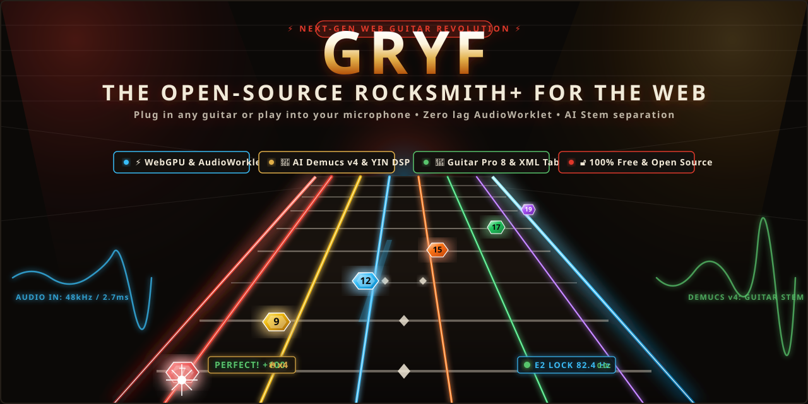
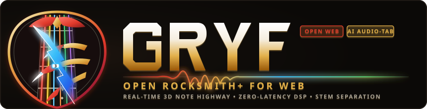

<div align="center">



<br/><br/>



<br/>

**The Open-Source Rocksmith+ for the Web — Real-time 3D Note Highway with Zero Latency & AI Audio-to-Tab**  
*Podłącz gitarę kablem audio lub graj akustycznie przed mikrofonem. 100% Free & Open Source.*

[](https://github.com/merx666/gryf-guitar/actions)
[](LICENSE)
[](https://react.dev)
[](https://tailwindcss.com)

</div>

---

## 🌟 Główne Możliwości

1. **Autostrada Nutowa 3D (Note Highway 60/120 FPS)**
   - Rzut perspektywiczny z kolorystyką strun Rocksmith (Czerwony, Żółty, Niebieski, Pomarańczowy, Zielony, Fioletowy).
   - Oznaczenia progów na pigułkach nutowych oraz linie rytmiczne taktów.
   - Detekcja trafień w oknie czasowym: *Idealnie* (<=35ms, 100 pkt), *Dobrze* (<=90ms, 60 pkt), *Pudło*.
   - Mnożniki punktów (x1, x2, x3, x4) i wskaźnik płonącej serii (Streak).

2. **Silnik Audio DSP o Skrajnie Niskiej Latencji**
   - Własny `AudioWorklet` działający w dedykowanym wątku audio (`latencyHint: 'interactive'`).
   - Fizyczne modelowanie strun (synteza Karplus-Strong).
   - Algorytm YIN połączony z dekompozycją harmoniczną dla precyzyjnego rozpoznawania wysokości dźwięku gitary (nawet przy mocnym przesterze i szumach).
   - Filtr brumienia sieci elektroenergetycznej 50Hz (standard europejski/polski) dla przetworników single-coil.

3. **Nowe Funkcjonalności & Narzędzia**
   - **Tuner Chromatyczny**: Wskazówka centów z dokładnością do 1 centa, automatyczne rozpoznawanie nastrojonych strun (E, A, D, G, B, e).
   - **Interaktywny Wirtualny Gryf & Eksplorator Skal**: 24 progi, skale (Pentatonika molowa/durowa, Skala bluesowa, Dorycka, Miksolidyjska, Ćwiczenie pajączek) z odsłuchem dźwięków.
   - **Kreator Kalibracji Opóźnienia**: Wizard z metronomem do precyzyjnej kompensacji bufora karty dźwiękowej/słuchawek Bluetooth.
   - **Import Tabulatur Guitar Pro**: Przeciągnij i upuść pliki `.gp`, `.gp3`, `.gp4`, `.gp5`, `.gpx` lub `.json` bezpośrednio do gry.
   - **Wirtualny Wzmacniacz Lampowy & Efekty**: Gain, Bass, Mid, Treble, Presence, bramka szumów, Bucket-Brigade Stereo Chorus oraz Taśmowy Echo Delay z modulacją wow & flutter.

4. **Trasa Koncertowa (8 Rozdziałów)**
   - Kampania fabularna z polskimi realiami scenicznymi pod okiem menadżerki Magdy (*Garaż u Matiego*, *Próby w Piwnicy*, *Lokalny Pub 'U Zdzicha'*, *Klub Underground*, *Finał Wojewódzki*, *Studio Nagraniowe*, *Trasa Krajowa*, *Festiwal Pol'and'Rock*).
   - 50 poziomów kariery muzycznej (od *Gitarzysty Sypialnianego* po *Żywą Legendę*).
   - 122 osiągnięcia i odznaki.

---

## 🛠️ Architektura i Technologie

```
src/
├── audio/
│   ├── audioEngine.ts       # Główny interfejs Web Audio API & MediaStream
│   ├── pitchDetector.ts     # Algorytm YIN + dekompozycja harmoniczna
│   └── sfxPlayer.ts         # Matematyczna synteza dźwięków UI bez assetów mp3
├── components/
│   ├── HighwayView.tsx      # Silnik renderowania Canvas 2D 60/120 FPS
│   ├── Header.tsx           # Pasek nawigacji ze wskaźnikiem nuty na żywo
│   ├── MainMenu.tsx         # Pulpit 6 głównych modułów (ui-ux-pro-max)
│   ├── TourView.tsx         # Trasa koncertowa i dialogi
│   ├── SongsView.tsx        # Baza 571 utworów rockowych
│   ├── GearView.tsx         # Panel wzmacniacza lampowego i efektów
│   ├── ProfileView.tsx      # Kariera, statystyki i 122 odznaki
│   ├── TunerModal.tsx       # Precyzyjny stroik chromatyczny
│   ├── FretboardModal.tsx   # Wirtualny gryf i analiza skal
│   ├── LatencyCalibrationModal.tsx # Pomiar i kompensacja latencji
│   └── TabImportModal.tsx   # Import plików Guitar Pro
└── data/
    ├── badgesData.ts        # Rangi i definicje odznak
    ├── scalesData.ts        # Gryf, interwały i wzorce skal
    └── tourData.ts          # Rozdziały i utwory kampanii
```

---

## 🚀 Uruchomienie Lokalne

Wymagane środowisko: **Node.js 20+** oraz **npm**.

```bash
# 1. Klonowanie repozytorium
git clone https://github.com/merx666/gryf-guitar.git
cd gryf-guitar

# 2. Instalacja zależności
npm ci

# 3. Uruchomienie w trybie developerskim
npm run dev
```

Aplikacja wystartuje pod adresem `http://localhost:3000`.

---

## 🐳 Wdrożenie Produkcyjne (Docker)

```bash
# Zbudowanie obrazu i uruchomienie kontenera na porcie 3000
docker compose up -d --build
```

Aplikacja posiada skonfigurowane nagłówki bezpieczeństwa i izolacji wątków (`Cross-Origin-Opener-Policy: same-origin` oraz `Cross-Origin-Embedder-Policy: require-corp`) umożliwiające bezproblemowe działanie `AudioWorklet` z najniższym buforem próbek audio.
