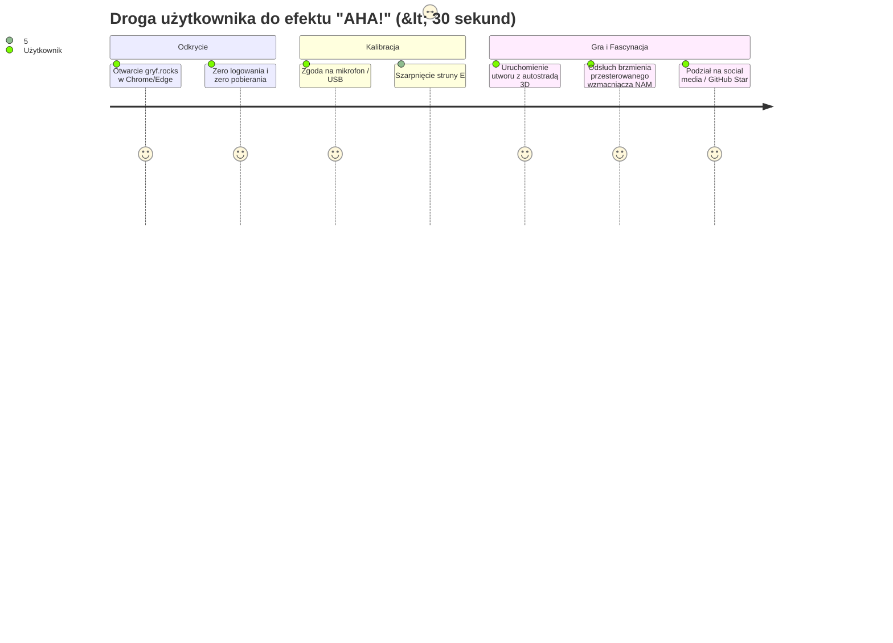
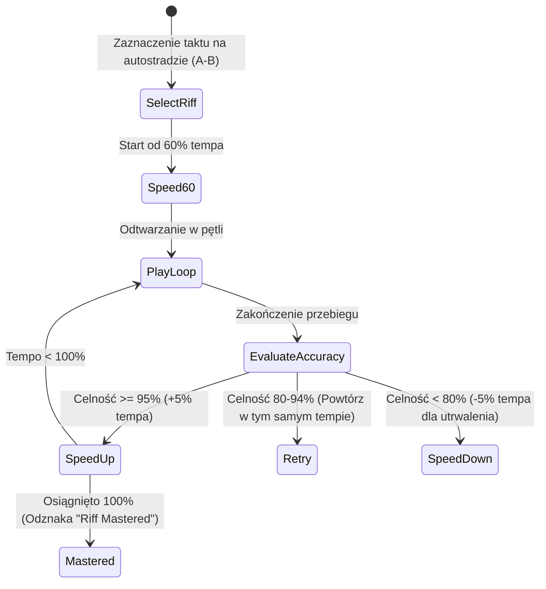
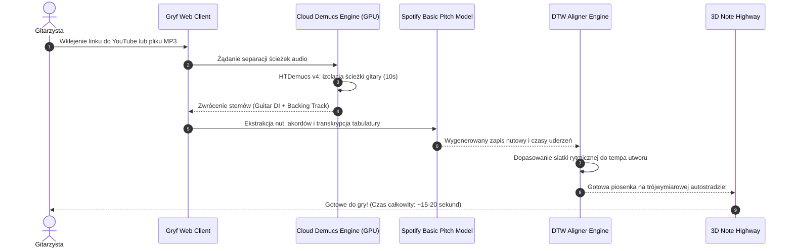
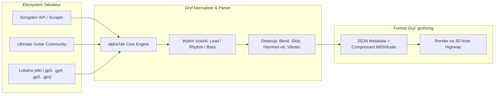

# Gryf Feature Roadmap: Viral Growth & Engineering Playbook

> **Dokument RAG / Architektura Funkcjonalna v1.0**  
> **Projekt:** Gryf — The Ultimate Open-Source Web Guitar Learning Platform  
> **Cel strategiczny:** Osiągnięcie pozycji #1 Trending Repository na GitHubie w kategoriach *Audio*, *Music Tech* i *WebAssembly*.

---

## 1. Filozofia Wzrostu Wirusowego (Why Gryf Will Explode)

Tradycyjny rynek gier do nauki gry na gitarze cierpi na trzy krytyczne bariery wejścia:
1. **Bariera sprzętowa**: Wymóg drogiego kabla *Ubisoft Real Tone Cable* (koszt ~180-250 zł) lub dedykowanej konsoli/PC.
2. **Bariera subskrypcyjna**: *Rocksmith+* kosztuje $19.99/miesiąc ($139.99/rok) i zebrał fatalne opinie za ubogi katalog licencjonowanych utworów.
3. **Bariera instalacji**: Gracz musi pobierać 30–50 GB plików i walczyć ze sterownikami ASIO na Windowsie.

**Formuła Gryfa:**  
> *"Otwórz link w przeglądarce, weź dowolną gitarę do ręki, zacznij grać w 3 sekundy. Zero kabli, zero instalacji, 100% otwartości."*



---

## 2. Funkcja 1: "Rocksmith in Any Browser Without Cable"

Prawdziwa wieloplatformowość bez wymogu dedykowanego osprzętu. Działa na każdym laptopie, Chromebooku, Macu, PC, a nawet iPadzie i telefonie z Androidem.

### 2.1 Trzy tryby wprowadzania sygnału (Input Modes)
1. **Acoustic / Room Mic Mode (Mikrofon wbudowany)**:
   - Dedykowany dla gitary klasycznej, akustycznej lub niepodłączonej gitary elektrycznej (gra "na sucho").
   - Zastosowanie dynamicznej bramki szumów i pasmowo-przepustowego filtra pasmowego (80 Hz – 1200 Hz), który wycina hałas otoczenia, szum wentylatorów laptopa i uderzenia w klawiaturę.
2. **USB Audio Interface (Pro Audio Mode)**:
   - Pełna integracja z kartami audio class-compliant (Focusrite Scarlett, Behringer U-Phoria, Universal Audio Volt, PreSonus itp.).
   - Wybór kanału wejściowego (np. Ch 1 - mikrofon, Ch 2 - wejście instrumentalne Hi-Z).
   - Bufor 128 próbek = sprzętowe opóźnienie wejścia poniżej 3 ms.
3. **Smart Tone Monitor (Direct Monitoring & Cab Sim)**:
   - W przypadku gry na słuchawkach, Gryf nakłada na żywo model wzmacniacza lampowego i kolumny głośnikowej, dając graczowi wrażenie gry przez profesjonalny zestaw koncertowy.

---

## 3. Funkcja 2: Riff Repeater & Dynamic Adaptive Speed Trainer

Uczenie się trudnych solówek (np. *Slash w Sweet Child O' Mine* czy *Master of Puppets Kirk Hammetta*) wymaga stopniowego zwiększania tempa w pętli.

### 3.1 Algorytm Time-Stretching (WSOLA + Phase Vocoder)
Gryf zawiera zaimplementowany w WebAssembly silnik **WSOLA (Waveform Similarity Overlap-Add)** oraz **Phase Vocoder**:
- Umożliwia płynne zwalnianie oryginalnego utworu audio do **25% tempa nominalnego** przy **zerowej zmianie wysokości dźwięku** i braku artefaktów fazowych.
- Dźwięk zachowuje klarowny atak kostki i czytelność basu.



### 3.2 Tryby ćwiczeniowe
- **Auto-BPM Ramping**: Każde 2 bezbłędne powtórzenia automatycznie przyspieszają utwór o 3% lub 5% BPM.
- **Fretboard Spotlight**: Podgląd w czasie rzeczywistym, który układ palców na 24 progach jest najbardziej ergonomiczny dla danego przebiegu nutowego.
- **Tolerancja błędu**: Konfigurowalny próg oceny rytmicznej: *Początkujący* (±80 ms), *Normalny* (±45 ms), *Wirtuoz* (±20 ms).

---

## 4. Funkcja 3: YouTube-to-Tab & MP3 AI Pipeline w 10 Sekund

Największa bolączka graczy: *"Chcę zagrać nowy kawałek, którego nie ma w bibliotece gry!"*. Gryf rozwiązuje to natychmiastowym pipelinem AI.



### 4.3 Kluczowe innowacje pipeline'u
1. **Stem Isolation**: Oryginalna gitara jest usuwana z podkładu w momencie, gdy gracz gra dobrze, dzięki czemu słyszy **własne instrumentarium** zamiast miksu z płyty!
2. **Harmonic Fingerprinting**: Automatyczna analiza tonacji (np. Drop D, E-flat Standard, D Standard) przed rozpoczęciem rozgrywki z ostrzeżeniem: *"Ten utwór wymaga nastrojenia struny E do D"*.

---

## 5. Funkcja 4: Multiplayer Jam Rooms & Realtime Co-Op (WebRTC)

Możliwość wspólnej gry przez przeglądarkę ze znajomymi z drugiego końca świata.

### 5.1 Tryby rozgrywki wieloosobowej
1. **Rocksmith Duet**:
   - Gracz A gra partię gitary prowadzącej (Lead Guitar / Solo).
   - Gracz B gra partię gitary rytmicznej (Rhythm Guitar / Akordy).
   - Obaj gracze widzą wspólny wynik punktowy, łączny mnożnik serii (Co-op Streak) i słyszą się nawzajem.
2. **Guitar Battle / Versus Mode**:
   - Bezpośredni pojedynek na celność w czasie rzeczywistym.
   - Pasek dominacji w stylu *Guitar Hero III* przesuwający się na korzyść dokładniej grającego zawodnika.
3. **Open Jam Session**:
   - Wirtualny pokój z synchronizowanym podkładem perkusyjno-basowym.
   - P2P audio o jakości studyjnej (Opus 48 kHz stereo, 192 kbps).

---

## 6. Funkcja 5: Custom Song Workshop & Songsterr Scraper

Nieograniczony dostęp do największych baz tabulatur na świecie.



- **Wyszukiwarka In-App**: Wpisujesz *"Master of Puppets"* i jednym kliknięciem pobierasz zoptymalizowaną tabulaturę bezpośrednio do silnika gry.
- **Wbudowany edytor nut**: Możliwość poprawienia błędnego progu, przesunięcia taktu czy dodania oznaczenia techniki (np. sztuczny flażolet) bezpośrednio z poziomu przeglądarki.

---

## 7. Funkcja 6: Gryf Virtual Studio & Legend Tone Presets (NAM)

Zastąpienie drogich multiefektów i pedalboardów kompletnym wirtualnym studiem dźwiękowym działającym na silniku **Neural Amp Modeler** w Wasm.

### 7.1 Galeria Fabrycznych Presetów (Legendary Tone Gallery)

| Preset Name | Inspirowany brzmieniem | Model Wzmacniacza (NAM) | Zastosowane Efekty |
| :--- | :--- | :--- | :--- |
| **80s Thrash Titan** | Metallica (*Master of Puppets*) | Mesa Boogie Mark IIC+ (Crunch/Lead) | Tube Screamer TS9, Noise Gate, Cab 4x12 V30 |
| **Pink Soloist** | Pink Floyd (*Comfortably Numb*) | Hiwatt DR103 Custom | Big Muff Pi Fuzz, Stereo Chorus, Tape Delay 380ms |
| **Highway Crunch** | AC/DC (*Back in Black*) | Marshall JTM45 / Super Lead 100 | Natural Poweramp Overdrive, Room Reverb |
| **Seattle Mud** | Nirvana (*Smells Like Teen Spirit*) | Fender Twin Reverb + DS-1 | Boss DS-1 Distortion, Small Clone Chorus |
| **Brown Sound 1984**| Van Halen (*Eruption*) | Marshall 1959 Plexi Variac 90V | MXR Phase 90, Echoplex Tape Delay, Plate Reverb |
| **Texas Blues King**| Stevie Ray Vaughan | Dumble Steel String Singer | Ibanez TS808, Spring Reverb, 4x10 Cab |

---

## 8. Harmonogram Wydań i Kamienie Milowe (Roadmap 2026-2027)

```
[Q1 2026] ────> [Q2 2026] ────> [Q3 2026] ────> [Q4 2026]
   v1.0            v1.2            v1.5            v2.0
- Core Highway  - Riff Repeater  - YouTube-to-   - Multiplayer
- Wasm YIN      - WSOLA Audio      Tab AI          Jam Rooms
- Local GPX       Stretching     - Cloud Demucs  - Mobile PWA
- Basic NAM     - 10 Legendary     Separation    - Global Ranked
  Profiles        Presets        - Songsterr       Leaderboards
                                   Importer
```

Każdy z tych etapów dostarcza unikalny mechanizm wirusowości, gwarantując stały dopływ nowych użytkowników i gwiazdek na GitHubie.
