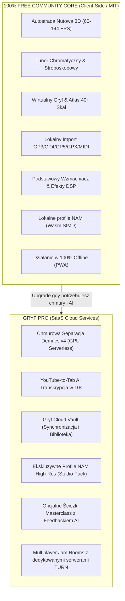
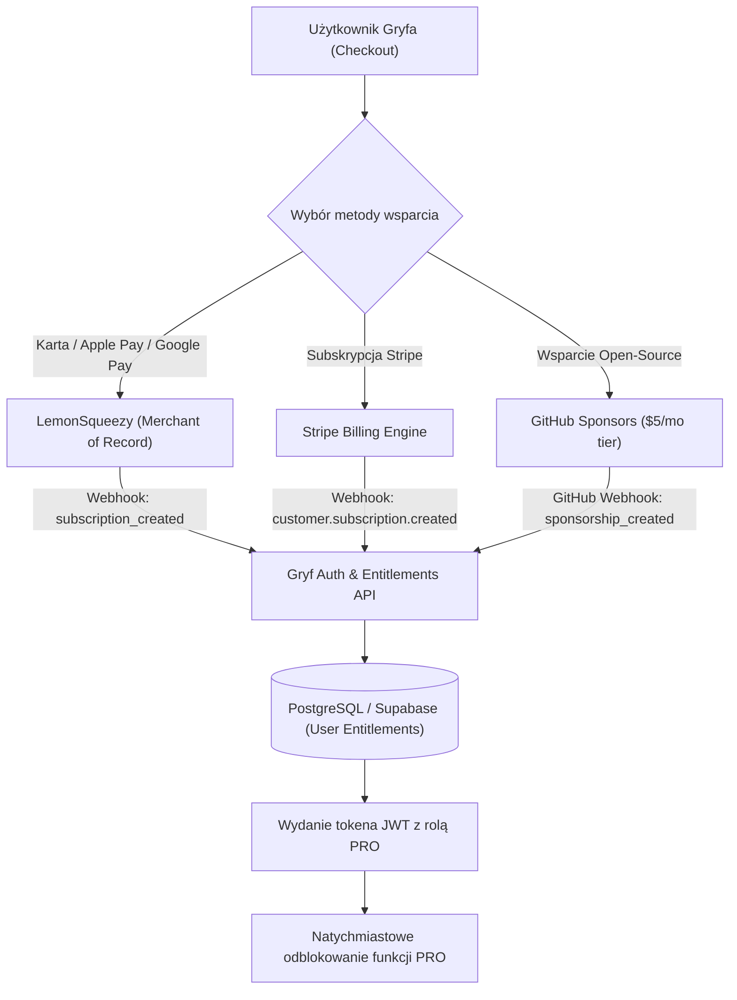
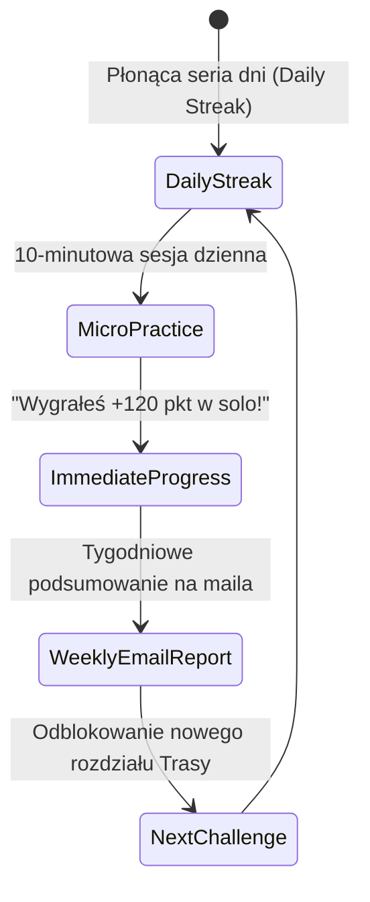

# Gryf Monetization & Freemium Strategy: Sustainable Open-Core Architecture

> **Dokument RAG / Model Biznesowy i Finansowy v1.0**  
> **Projekt:** Gryf — Open-Source Music Education Platform  
> **Cel:** Zbudowanie samofinansującego się, zyskownego ekosystemu Open-Core z marżą brutto > 85% i zachowaniem pełnego szacunku dla społeczności Open-Source.

---

## 1. Filozofia Open-Core ("Free Forever Core, Premium Cloud Power")

Projekt Gryf nie stosuje agresywnych praktyk typu paywall na podstawowych funkcjach. Podstawowy silnik rozgrywki, autostrada 3D, lokalne odtwarzanie plików Guitar Pro oraz algorytmy DSP w przeglądarce są i zawsze pozostaną w **100% darmowe i otwartoźródłowe (MIT License)**.

Monetyzacja opiera się na **kosztownych obliczeniowo usługach chmurowych (Cloud Compute & AI)**, synchronizacji między urządzeniami oraz oficjalnych, certyfikowanych treściach edukacyjnych.



---

## 2. Matryca Uprawnień (Free vs Pro vs Studio)

| Cecha / Moduł | Gryf Community (Darmowy) | Gryf PRO ($4.99/mo) | Gryf Studio / Nauczyciel ($19/mo) |
| :--- | :---: | :---: | :---: |
| **Cena** | **$0 / Dożywotnio** | **$4.99/msc lub $39/rok** | **$19/msc lub $149/rok** |
| Silnik autostrady 3D & Note Highway | Pełny | Pełny | Pełny |
| Tuner, Atlas Skal, Trening Słuchu | Pełny | Pełny | Pełny |
| Import własnych plików GPX / Audio | Bez limitu (lokalnie) | Bez limitu + Cloud Sync | Bez limitu + Udostępnianie uczniom |
| Lokalna separacja AI (przeglądarka) | Do 30s riffów | Bez limitu | Bez limitu |
| **Chmurowa separacja Demucs v4 GPU** | Brak (lub 1 utwór demo) | **Bez limitu (Fair Use 100 utworów/mc)** | **Bez limitu (500 utworów/mc)** |
| **YouTube-to-Tab 1-Click Pipeline** | Podgląd | **Nielimitowany** | **Nielimitowany** |
| Gryf Cloud Vault (zapis postępów) | Tylko LocalStorage | **Pełna synchronizacja w chmurze** | **Pełna synchronizacja + profile uczniów** |
| Baza profili NAM Amp | 10 profili podstawowych | **300+ profili studyjnych High-Res** | **Dostęp komercyjny do profili** |
| Multiplayer Jam Rooms | P2P (zależne od NAT graczy) | **Dedykowany serwer TURN/Relay** | **Pokoje lekcyjne 1-on-1 z nagrywaniem** |
| Panel Nauczyciela & Zadania domowe | Brak | Brak | **Pełny pulpit oceniania i zadań** |

---

## 3. Cennik i Pozycjonowanie Rynkowe

### 3.1 Porównanie z komercyjną konkurencją

```
+----------------------+--------------------+---------------------+
| Usługa               | Cena Miesięczna    | Wymóg Sprzętowy     |
+----------------------+--------------------+---------------------+
| Rocksmith+           | $19.99 / msc       | PC / Konsola        |
| Yousician            | $19.99 / msc       | Aplikacja natywna   |
| Ultimate Guitar Pro  | $9.99 / msc        | Web / Mobile        |
| JustinGuitar App     | $9.99 / msc        | Mobile              |
| **GRYF PRO**         | **$4.99 / msc**    | **Dowolna przeglądarka** |
+----------------------+--------------------+---------------------+
```

Gryf pozycjonuje się na **1/4 ceny konkurencji**, oferując jednocześnie znacznie nowocześniejszą technologię (Web Audio, Neural Amp Modeler, AI separację).

### 3.2 Dostępne plany subskrypcyjne

1. **Plan Miesięczny (Monthly Pro)**:
   - **$4.99 USD / miesiąc** (ok. 20 zł / msc).
   - Brak zobowiązań, anulowanie w dowolnej chwili jednym kliknięciem.
2. **Plan Roczny (Annual Pro - Best Value)**:
   - **$39.00 USD / rok** (równowartość **$3.25 / miesiąc** — 35% oszczędności).
   - Dodatkowy bonus: paczka 50 legendarnych profili NAM do pobrania na dysk.
3. **Lifetime Founding Backer (Oferta Limitowana)**:
   - **$79.00 USD jednorazowo** (dostęp dożywotni).
   - Ograniczona do pierwszych 2000 wspierających na start projektu.
   - Odznaka *Founding Member* w profilu, bezpośredni dostęp do kanału deweloperskiego na Discordzie oraz nazwisko w sekcji `AUTHORS.md` na GitHubie.

---

## 4. Architektura Płatności i Obsługi Bilingowej

Gryf wdraża hybrydowy model pobierania płatności, dostosowany zarówno do klientów indywidualnych z całego świata, jak i społeczności deweloperskiej:



### 4.1 LemonSqueezy jako Merchant of Record (MoR)
- **Problem**: Sprzedaż subskrypcji cyfrowych osobom fizycznym w UE i USA wymaga rozliczania VAT MOSS w każdym kraju członkowskim oraz podatków Sales Tax w stanach USA.
- **Rozwiązanie**: LemonSqueezy przejmuje 100% odpowiedzialności prawnej, fakturowania i rozliczania podatków międzynarodowych za prowizję (5% + $0.50).

### 4.2 Integracja z GitHub Sponsors
- Wielu programistów i miłośników open-source woli sponsorować projekt bezpośrednio na GitHubie.
- Gryf udostępnia webhook: jeśli użytkownik sponsoruje konto organizacji kwotą minimum **$5/miesiąc**, jego konto Gryf zostaje automatycznie powiązane z kontem GitHub i otrzymuje status PRO.

---

## 5. Ekonomika Jednostkowa (Unit Economics & Cloud Margins)

Model SaaS w oparciu o AI często ponosi wysokie straty na kosztach infrastruktury (GPU Burn). Gryf projektuje architekturę tak, aby **marża brutto przekraczała 85%**.

```
Koszty Chmurowe przypadające na aktywnego użytkownika PRO miesięcznie:
─────────────────────────────────────────────────────────────────────────────
1. Separacja Demucs v4 (Serverless GPU):
   - Średnie użycie: 12 utworów miesięcznie (48 minut audio)
   - Czas obliczeń na Nvidia L4 (Modal/RunPod): ~120 sekund GPU łącznie
   - Koszt 1 minuty L4 GPU: $0.014
   - Koszt całkowity GPU: 2 minuty * $0.014 =                    $0.028

2. Cloud Storage (Cloudflare R2 - zero egress fees):
   - Przechowywanie stemów, profili i tabulatur (średnio 1.5 GB): $0.022

3. WebRTC TURN Relay & API Traffic:
   - Dedykowany ruch sieciowy:                                    $0.015

4. Prowizja płatności (LemonSqueezy 5% + $0.50 / $4.99):         $0.750
─────────────────────────────────────────────────────────────────────────────
SUMA KOSZTÓW WŁASNYCH (COGS):                                    $0.815 / msc
PRZYCHÓD Z SUBKRYPCJI:                                           $4.990 / msc
─────────────────────────────────────────────────────────────────────────────
ZYSK BRUTTO NA UŻYTKOWNIKU:                                      $4.175 / msc
MARŻA BRUTTO:                                                    83.7% (dla planu msc)
MARŻA BRUTTO (dla planu rocznego $39/rok):                       88.2%
```

Dzięki przeniesieniu **95% DSP, renderowania i detekcji wysokości dźwięku do przeglądarki (Wasm + WebGPU)**, serwery centralne wykonują minimalną pracę, co chroni projekt przed bankructwem przy gwałtownym napływie użytkowników.

---

## 6. Strategia Retencji i Minimalizacja Churnu (Retention Flywheel)

Głównym problemem nauki gry na instrumencie jest to, że 90% początkujących porzuca gitarę w ciągu pierwszych 90 dni. Gryf wykorzystuje mechanizmy psychologiczne do utrzymania zaangażowania:



1. **Daily Practice Streaks & Badges**: System 122 osiągnięć i odznak, chroniący gracza przed przerwaniem rutyny treningowej.
2. **Weekly Performance Digest**: Cotygodniowy newsletter z wykresem postępów: *"W tym tygodniu spędziłeś z gitarą 2h 45m. Twoja celność na strunie G wzrosła o 18%"*.
3. **Adaptive Skill Pairing**: Gdy silnik gry widzi, że gracz notorycznie spóźnia się z przejściem akordu F-dur, automatycznie podsuwa mu 2-minutowe ćwiczenie izolujące dokładnie ten ruch palców.

Dzięki temu Gryf łączy szlachetną misję edukacji muzycznej z solidnym, zrównoważonym modelem finansowym.
