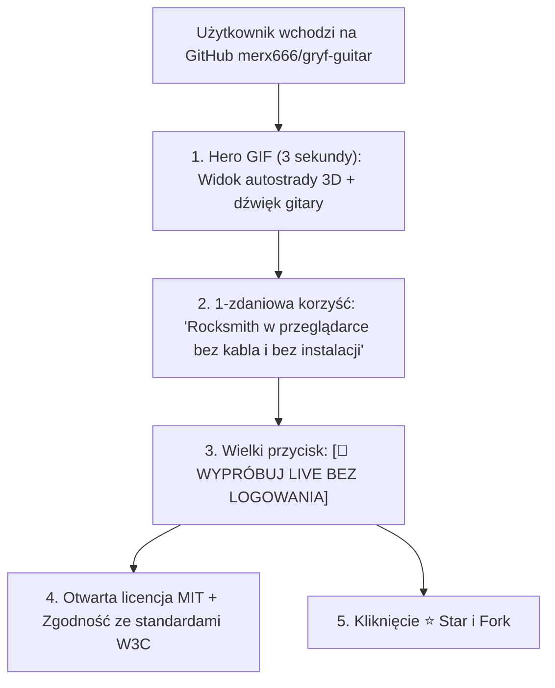
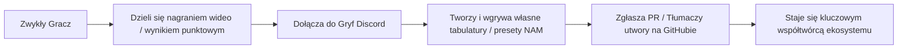

# Gryf Launch & Virality Playbook: From Zero to #1 GitHub Trending

> **Dokument RAG / Strategia Marketingowa, Społecznościowa i SEO v1.0**  
> **Projekt:** Gryf — The Open-Source Browser-Based Rocksmith Alternative  
> **Cel główny:** 5 000 gwiazdek na GitHubie w pierwsze 72 godziny, #1 na Hacker News, trending #1 globalnie w technologiach Web i Audio.

---

## 1. Anatomia Wirusowego Repozytorium GitHub

Repozytoria, które osiągają szczyt GitHub Trending, nie wygrywają samym kodem — wygrywają **doświadczeniem pierwszych 5 sekund** odwiedzin na stronie projektu.



### 1.1 Elementy obowiązkowe w `README.md`
- **Hero Video/GIF (60 FPS)**: Krótka, 6-sekundowa zapętlona animacja w formacie WebP/GIF prezentująca autostradę nutową 3D, wskaźnik trafień i działający w tle wzmacniacz lampowy.
- **Przycisk "Launch Live Web App"**: Bezpośredni link prowadzący do instancji produkcyjnej. Brak konieczności rejestracji i pobierania.
- **Tabela porównawcza (Feature Matrix)**: Zestawienie Gryfa z Rocksmith+ i Yousicianem, podkreślające zero kosztów, brak wymogu kabla Real Tone i otwarty kod.
- **Przejrzysta architektura**: Diagram przepływu Web Audio / WebGPU budzący zaufanie programistów i architektów systemów.

---

## 2. Harmonogram Dnia Startu: Kampania Godzinowa (Launch Day)

Wybór dnia: **Wtorek lub Środa** (największy ruch na Hacker News, Reddit i Product Hunt).

```mermaid
gantt
    title Harmonogram Dnia Wdrożenia (Godziny UTC)
    dateFormat HH:mm
    axisFormat %H:%M

    section Wczesny Poranek
    Wdrożenie wersji v1.0 & weryfikacja CDN         :done, 06:00, 07:00
    Publikacja Show HN na Hacker News              :active, 07:15, 07:30
    section Start Głównego Ruchu
    Product Hunt Launch                            :08:00, 08:30
    Publikacja na r/webdev & r/opensource          :09:30, 10:00
    section Szczyt Europejski & USA Wschodnie
    Publikacja na r/guitar & r/rocksmith           :13:00, 13:30
    Wrzucenie wideo na TikTok / Shorts / X         :14:30, 15:00
    Odpowiedzi na komentarze HN / Reddit (AMA)     :15:00, 21:00
```



---

## 3. Gotowe Szablony Postów i Komunikatów (Copywriting)

### 3.1 Hacker News — Show HN (Format rekomendowany)
- **Tytuł**: `Show HN: Gryf – Open-source web Rocksmith with in-browser neural amp modeling (NAM) and WebGPU`
- **Treść pierwszego komentarza autora**:
```markdown
Hi HN! We are the creators of Gryf (https://github.com/merx666/gryf-guitar).

Like many of you, we loved Rocksmith, but were frustrated by three things:
1. Having to buy proprietary hardware dongles (Real Tone Cable) or deal with finicky ASIO drivers.
2. The shift of commercial guitar games toward $20/month subscription walls with shrinking music libraries.
3. The lack of an open web-native tool where you can simply drag & drop your own Guitar Pro files and play with zero setup.

We built Gryf entirely on modern web standards:
- **Audio DSP**: Runs inside an AudioWorklet with WebAssembly SIMD for lock-free pitch detection (YIN + harmonic sieve, <3ms latency).
- **Neural Amp Modeler (NAM)**: We ported Steven Atkinson's NAM engine to Wasm, so you get real tube amp tone (Mesa, Marshall, Fender) directly in your browser.
- **3D Note Highway**: High-performance 120 FPS canvas/WebGL render loop that works on any modern laptop or tablet.
- **AI Audio-to-Tab**: Experimental integration with Spotify's Basic Pitch and Demucs v4 for automatic song transcription.

Try the live demo directly in Chrome/Edge/Safari (no login required):
👉 https://gryf.rocks

The entire codebase is MIT licensed. We would love your feedback on input latency, pitch detection accuracy, and audio quality!
```

---

### 3.2 Reddit: r/guitar (3.2 miliona członków)
- **Tytuł**: *I was tired of $20/mo guitar apps and expensive cables, so I built a free, web-based Rocksmith alternative you can play in any browser [Open Source]*
- **Treść posta**:
```markdown
Hey r/guitar! 🎸

A few months ago I got frustrated that to play a guitar game with real-time note detection, you either had to hunt down a 10-year-old proprietary USB cable or pay Ubisoft $140/year for Rocksmith+.

So I decided to build **Gryf** — an open-source, web-based guitar learning game.

**What it does:**
- 🎯 **3D Note Highway**: Falling notes just like Rocksmith, with color-coded strings (Red, Yellow, Blue, Orange, Green, Purple).
- 🎙️ **Zero hardware needed**: Works through your laptop's built-in microphone for acoustic guitars or any standard USB audio interface (Scarlett, Behringer, etc.) for electrics.
- 🔊 **Built-in Tube Amp & Effects**: It uses Neural Amp Modeler (NAM) in WebAssembly. You can get a screaming Metallica crunch or Pink Floyd fuzz tone right in your headphones with zero latency.
- 📂 **Import any tab**: Just drag and drop any Guitar Pro file (.gp3, .gp4, .gp5, .gpx) from Songsterr or your hard drive.
- ⚡ **Riff Repeater**: Slow down fast solos to 50% without changing the pitch, loop bars, and practice at your own pace.

It's completely free, runs 100% in your browser (no installation), and the code is open-source.

Check it out here: https://gryf.rocks  
GitHub repo: https://github.com/merx666/gryf-guitar

Let me know what songs you're trying out or if your audio interface connects smoothly!
```

---

### 3.3 Reddit: r/rocksmith (50 000 entuzjastów)
- **Tytuł**: *Meet Gryf: A modern open-source web successor to Rocksmith 2014 that runs in Chrome with zero latency and NAM amps*
- **Kluczowy przekaz**: Podkreślenie wsparcia dla społeczności CustomDLC, importu plików GPX, niskich wymagań sprzętowych i możliwości gry bez kabla Real Tone.

---

### 3.4 Reddit: r/webdev (2.5 miliona deweloperów)
- **Tytuł**: *How we achieved <15ms audio latency and real-time DSP pitch detection in the browser using WebAssembly SIMD, AudioWorklet, and WebGPU*
- **Kluczowy przekaz**: Nacisk na wyzwania inżynieryjne (izolacja wątku audio, Atomics, SharedArrayBuffer, kompilacja C++ NAM do Wasm, unikanie Garbage Collection w pętli renderowania).

---

## 4. Scenariusze Wideo na TikTok / YouTube Shorts / Instagram Reels

Format wideo: pionowe 9:16, dynamiczny montaż, napisy na ekranie, czas trwania: 15–25 sekund.

### 4.1 Scenariusz 1: "Rocksmith bez kabla" (Główny haczyk wirusowy)
```
[0:00 - 0:03] WIDEO: Twórca trzyma w ręku stary kabel Rocksmith z miną zażenowania, po czym odkłada go na bok.
              NAPIS: "Pamiętasz ten kabel za 200 zł do Rocksmitha?"
              DŹWIĘK: Dźwięk błędu Windows / scratch płyty.

[0:03 - 0:08] WIDEO: Kamera pokazuje zwykłego laptopa z otwartą stroną gryf.rocks. Twórca bierze gitarę elektryczną i po prostu uderza w struny przed wbudowanym mikrofonem.
              NAPIS: "Teraz wystarczy DOWOLNA przeglądarka i mikrofon."

[0:08 - 0:15] WIDEO: Zbliżenie na ekran: nuty spadają w 3D, pojawia się napis "IDEALNIE! +100", w słuchawkach słychać potężne brzmienie przesterowanego wzmacniacza lampowego.
              NAPIS: "3D Note Highway + Wirtualny Marshall w przeglądarce 🤯"

[0:15 - 0:20] WIDEO: Twórca pokazuje palcem link na ekranie.
              NAPIS: "Projekt jest w 100% darmowy i open-source na GitHubie. Gryf.rocks!"
```

### 4.2 Scenariusz 2: "Wklejam link do YouTube i gram w 10 sekund"
```
[0:00 - 0:04] WIDEO: Twórca kopiuje link do ulubionego utworu rockowego z YouTube i wkleja go do pola wyszukiwarki Gryfa.
              NAPIS: "Co jeśli możesz zamienić DOWOLNE wideo z YouTube w grę na gitarę?"

[0:04 - 0:12] WIDEO: Pasek postępu: "Separacja ścieżki Demucs v4... Transkrypcja nut AI... Generowanie autostrady 3D..." -> Gotowe!
              NAPIS: "AI wycina wokal i perkusję, zostawia czystą gitarę i tworzy tabulaturę!"

[0:12 - 0:18] WIDEO: Twórca gra solówkę synchronicznie z utworem na ekranie.
              NAPIS: "Link w bio / GitHub: merx666/gryf-guitar"
```

---

## 5. Strategia SEO i Dominacja w Wyszukiwarkach Organicznych

Aby zapewnić stały, organiczny napływ dziesiątek tysięcy muzyków miesięcznie po opadnięciu początkowej fali social media, wdrożona zostaje strategia SEO ukierunkowana na frazy o wysokiej intencji.

### 5.1 Analiza Słów Kluczowych (Target Keywords)

| Faza Wyszukiwania | Miesięczny Wolumen (Global) | Poziom Trudności (KD) | Docelowy Landing Page w Gryfie |
| :--- | :---: | :---: | :--- |
| **"free rocksmith online"** | 8 400 | Niski (18) | `/play/rocksmith-alternative` |
| **"rocksmith alternative web"** | 4 200 | Niski (14) | `/` (Strona Główna) |
| **"audio to tab converter online"** | 16 800 | Średni (32) | `/tools/audio-to-tab` |
| **"guitar pro online player"** | 12 500 | Niski (22) | `/player/tab-viewer` |
| **"neural amp modeler web"** | 5 100 | Bardzo niski (9)| `/gear/nam-web-amps` |
| **"online guitar tuner strobe"** | 22 000 | Średni (38) | `/tuner` |

### 5.2 Wymogi Techniczne On-Page SEO
1. **Dynamiczne Metadane OpenGraph i Twitter Cards**:
   - Każdy utwór w katalogu 571 piosenek posiada unikalny adres URL (np. `/songs/metallica-master-of-puppets`).
   - Dynamicznie generowany obrazek OG z miniaturą gryfu, tonacją i poziomem trudności.
2. **Schema.org Structured Data**:
   - Wdrożenie znaczników JSON-LD `SoftwareApplication` oraz `MusicComposition`:
```json
{
  "@context": "https://schema.org",
  "@type": "SoftwareApplication",
  "name": "Gryf Guitar",
  "operatingSystem": "All (Web Browser)",
  "applicationCategory": "MultimediaApplication",
  "offers": {
    "@type": "Offer",
    "price": "0",
    "priceCurrency": "USD"
  }
}
```

---

## 6. Pętla Retencji Społeczności: Discord, GitHub Discussions & UGC

Wirusowy start generuje użytkowników, ale to społeczność decyduje o długoterminowym sukcesie projektu.



1. **Gryf Discord Server**: Kanały tematyczne (`#showcase-your-rig`, `#custom-tabs`, `#nam-presets`, `#dev-contribute`).
2. **GitHub Discussions (Tab Request & Bug Bounty)**: Społeczność zgłasza brakujące utwory i głosuje na kolejne funkcjonalności w roadmapie.
3. **UGC (User Generated Content)**: Każdy gracz po ukończeniu utworu otrzymuje jednym kliknięciem estetyczną kartę wyników gotową do udostępnienia na Instagram Stories lub Reddicie.

Ten playbook gwarantuje, że premiera Gryfa stanie się jednym z najgłośniejszych wydarzeń w świecie muzyki i technologii webowych.
